# macOS Native for Anki

An Anki add-on that makes Anki's main window look and behave like a native macOS 27 app. It adds a unified toolbar, Liquid Glass controls, inset grouped lists, and one clear next action on every screen.

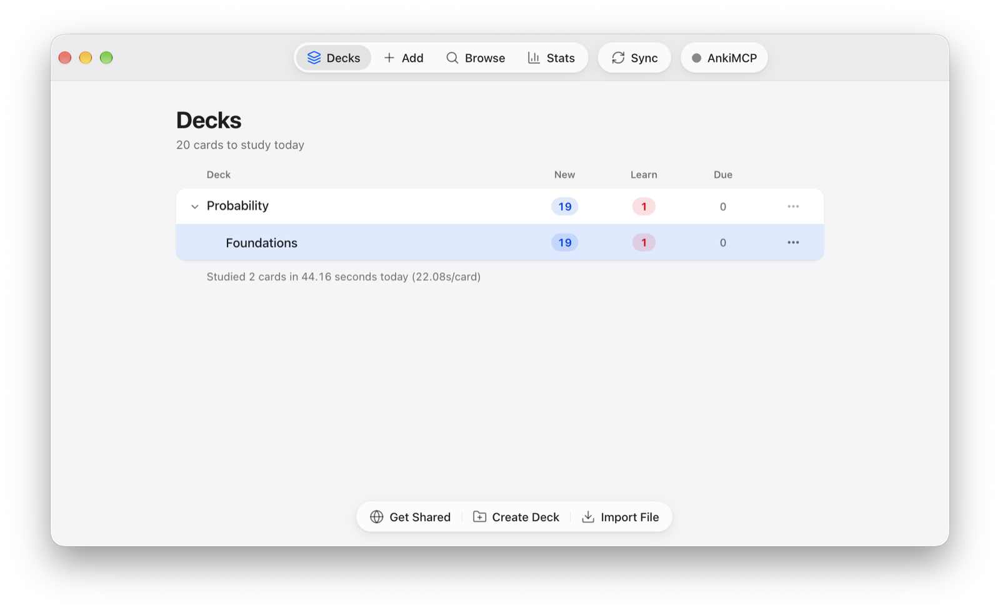

| | Light | Dark |
|---|---|---|
| **Deck list** |  | 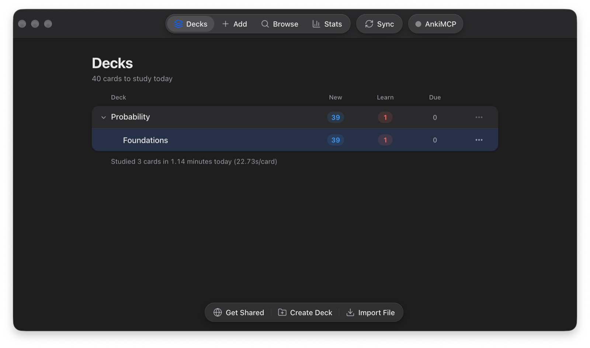 |
| **Overview** | 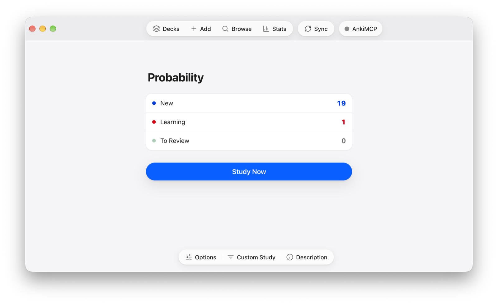 | 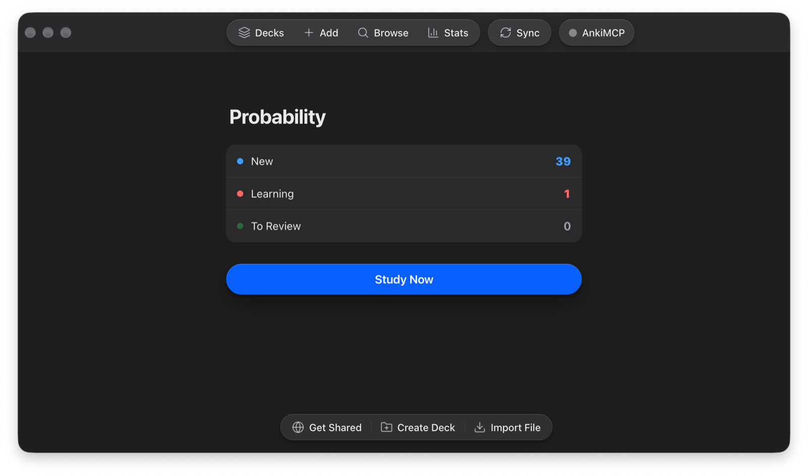 |
| **Question** | 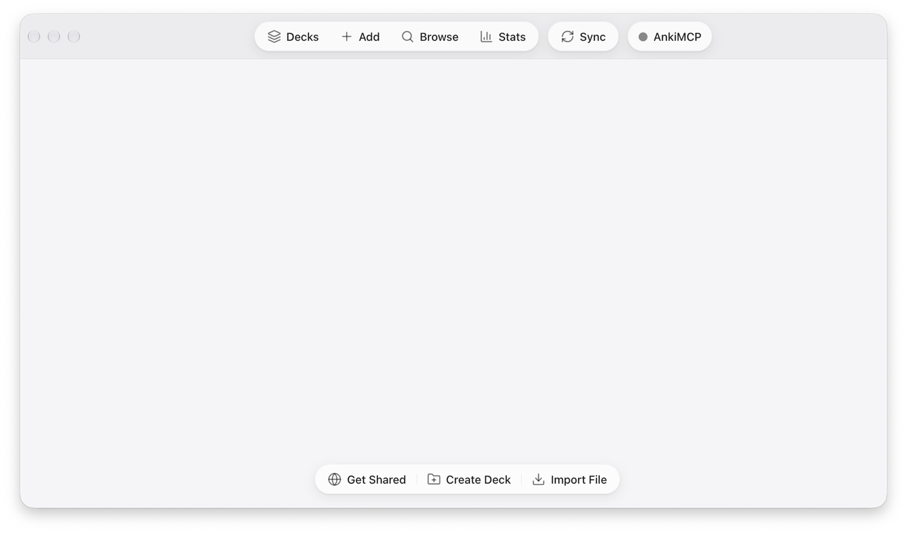 | 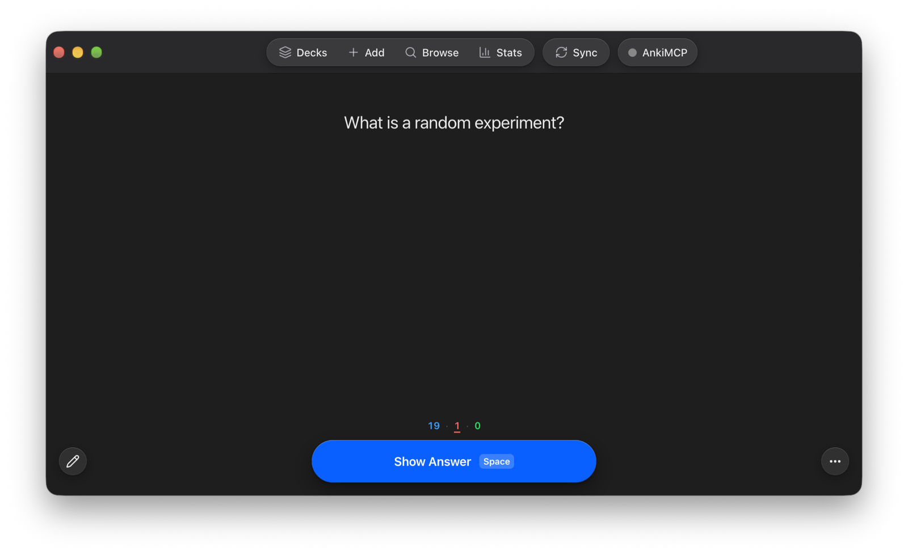 |
| **Answer** |  | 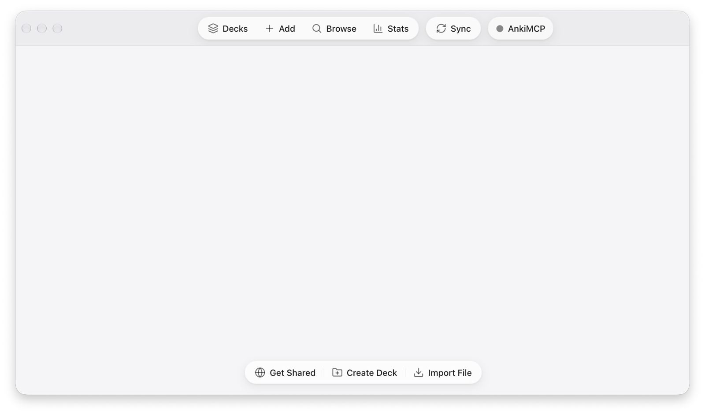 |
| **Deck Options** | 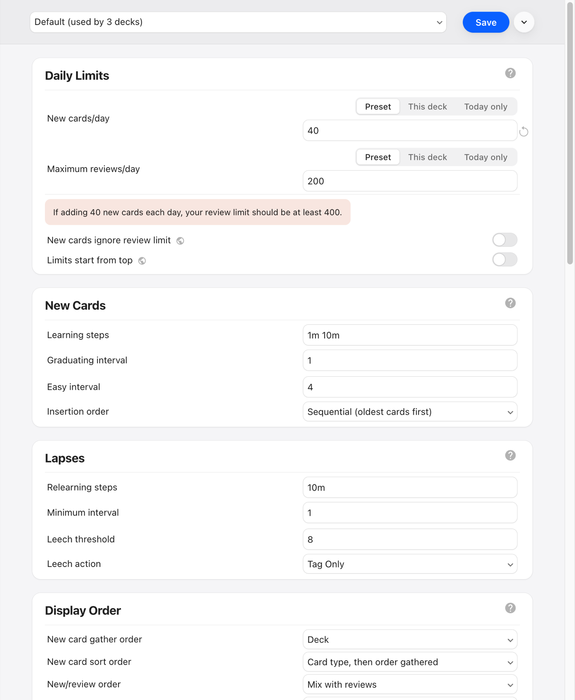 | 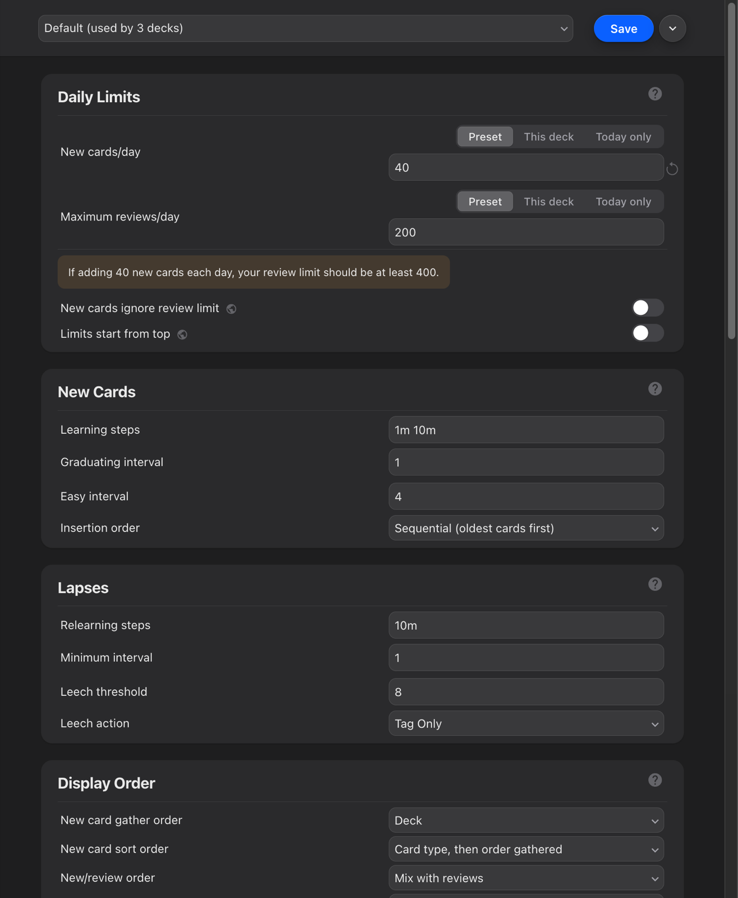 |
| **Menu** | 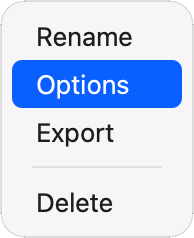 | 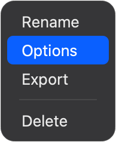 |
| **Add** | 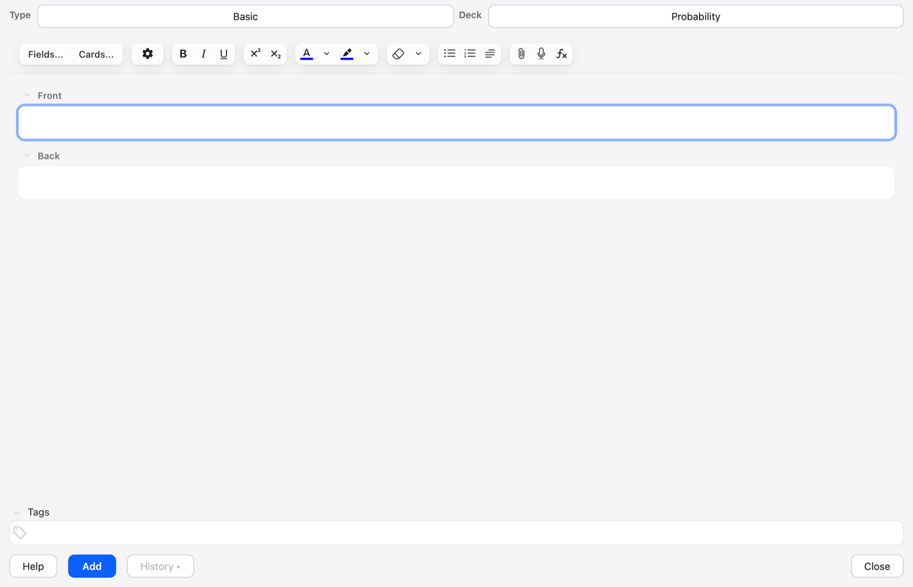 | 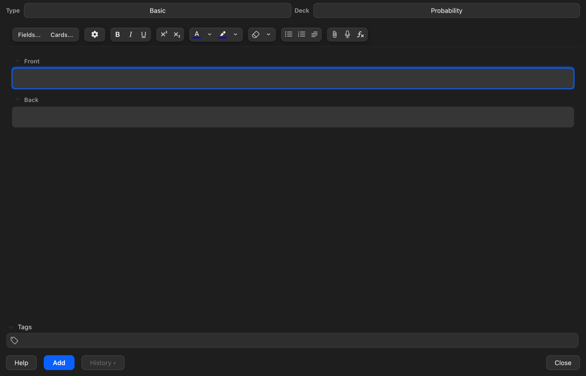 |
| **Statistics** | 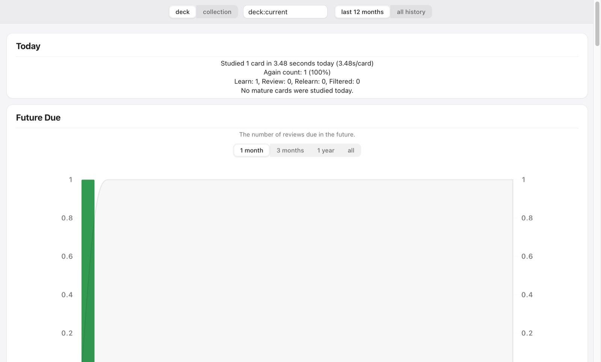 | 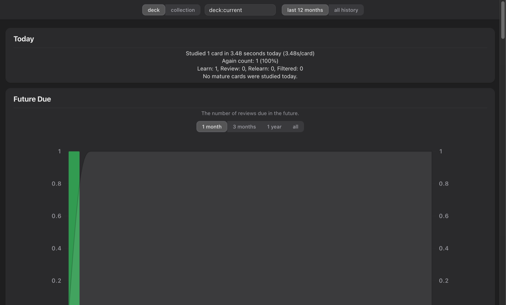 |

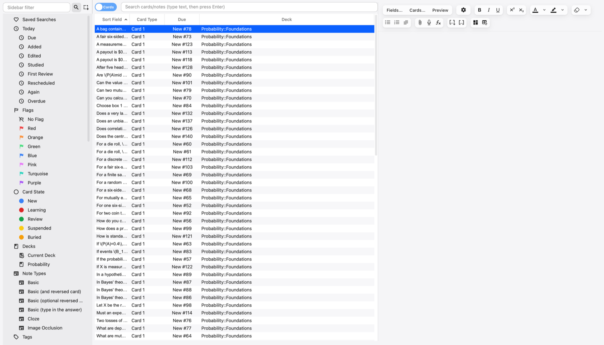

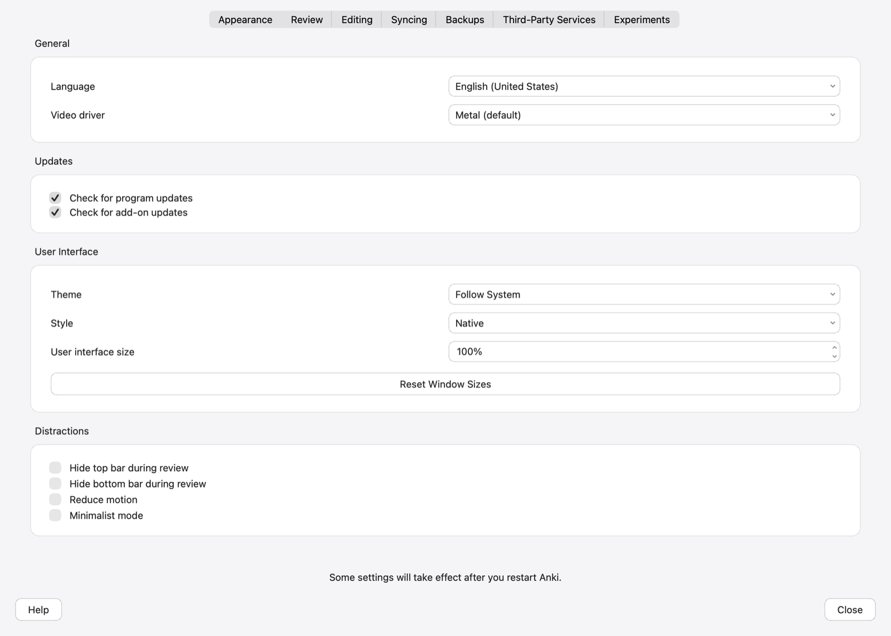

## What it changes

- **Unified toolbar.** The toolbar merges into the title bar, with the traffic lights on its centre line. Dragging empty toolbar space moves the window. Double-clicking it follows *System Settings → Desktop & Dock → Double-click a window's title bar*.
- **Deck list.** Decks show as an inset grouped list with a large title and a "cards to study today" summary. Counts appear as colour-tinted badges, and subdecks have disclosure chevrons. Click anywhere on a row to open the deck.
- **Deck overview.** It shows a large title, a three-row New / Learning / To Review summary and one prominent **Study Now** button.
- **Reviewer.**
  - The card sits on the window ground in the system font.
  - A floating capsule turns from **Show Answer** into four grade segments (Again / Hard / Good / Easy). Each segment shows its interval and a keycap for its shortcut. The morph is skipped when Anki's *Reduce motion* is on.
  - Mark and flag show as small glass badges.
- **Deck Options.** It looks like System Settings:
  - grouped sections with quiet titles and hairline rows
  - segmented controls for Preset / This deck / Today only
  - native-looking fields, pop-ups, switches and sliders
  - a toolbar strip with the preset menu and an accent **Save** button
- **Browse.** Browse gets a source-list sidebar, rounded search and filter fields, and a gridless table with a quiet header and your accent as the selection. Anki's row colours for flags, marks and suspended cards are kept.
- **Add / Edit.** The note-type and deck choosers become pop-up buttons, and **Add** is the accent button. In the note editor, toolbar groups become glass capsules, field labels are quiet, and fields are rounded with an accent focus ring.
- **Statistics.** It looks like the other settings-style screens: a toolbar strip with segmented controls for the deck/collection and period choices, grouped panels with quiet titles, segmented controls on every chart, and quieter axes. Anki's chart colours are kept.
- **Preferences.** It looks like System Settings: white grouped panels with section titles on the window ground, the shared field and button styles, and native tabs and check boxes.
- **Menus.** Popup menus are macOS-style: the deck "…" menu, the reviewer's More menu and context menus get a rounded translucent panel, an inset accent highlight and system type.
- **Theme.** It follows Anki's Light / Dark / System theme and your macOS accent colour. Text on the accent switches between white and black to stay readable.

It changes presentation only. Anki's own buttons, links, keyboard shortcuts, deck drag-and-drop, shift-click selection and other add-ons' toolbar items keep working.

## Install

1. Download the latest `anki-macos-native-<version>.ankiaddon` from [Releases](https://github.com/antonio-orionus/anki-macos-native/releases/latest).
2. Double-click it, or in Anki go to **Tools → Add-ons → Install from file…** and choose it.
3. Restart Anki.

To uninstall, go to **Tools → Add-ons**, select *macOS Native* and click **Delete**.

### Requirements

- Anki **25.02 or newer**. It is developed and tested on **26.9.3**.
- macOS. The unified title bar needs the Qt 6.9+ window hints that Anki 26.x ships. On older builds the add-on keeps the standard title bar and restyles everything else.
- Windows and Linux are untested. The title-bar code only runs on macOS, but the rest is plain CSS and JS.

## Settings

Go to **Tools → Add-ons → macOS Native → Config**.

| key | default | effect |
|---|---|---|
| `unified_titlebar` | `true` | Merge the toolbar into the title bar. Restart Anki after changing it. |
| `restyle_cards` | `true` | Set card text in the system font on the window background. Use `false` to show your note types' own styling unchanged. |
| `accent` | `"system"` | Follow the macOS accent colour, or set a hex colour such as `"#ff2d55"`. |
| `restyle_menus` | `true` | macOS-style popup menus. Restart Anki after changing it. |
| `restyle_windows` | `true` | macOS styling for the Browse and Add / Edit windows. Restart Anki after changing it. |

## Roadmap

The Congratulations screen, Card Layout, Card Info, the Previewer and a few smaller dialogs still keep Anki's look. See [ROADMAP.md](ROADMAP.md).

## Credits

Icons are from [Lucide](https://lucide.dev) (ISC licence). The add-on itself is [MIT](LICENSE).
